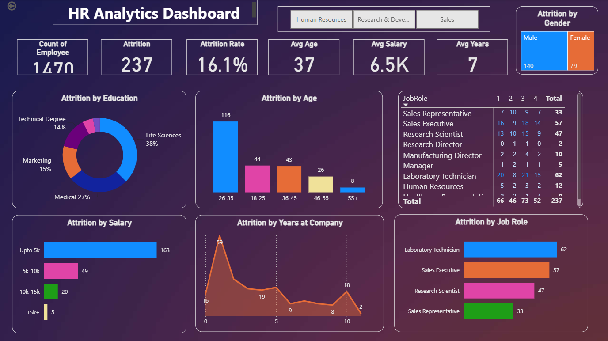

# HR & Workforce Intelligence Dashboard

## Overview
An end-to-end HR analytics project designed to help organizational leaders monitor employee turnover, identify key drivers of attrition, and make data-driven workforce decisions.

## Visual Dashboard Preview

## Key Metrics & DAX Measures
- **Total Employees**: Count of all active and past employees.
- **Attrition Count**: Total number of employees who left the company.
- **Attrition Rate**: Percentage of attrition relative to total workforce.
- **Avg Age & Avg Tenure**: Demographic and experience overview.

## Tools & Technologies
- **Power BI**: Data modeling, DAX measures, dark-themed UI formatting.
- **SQL**: Exploratory data analysis and metric extraction.
- **CSV Data Source**: IBM HR Analytics Employee Attrition dataset.
